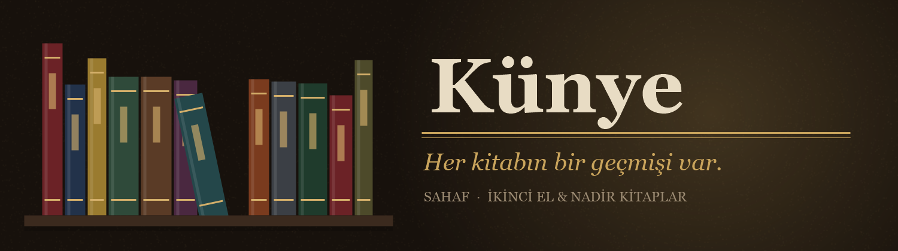
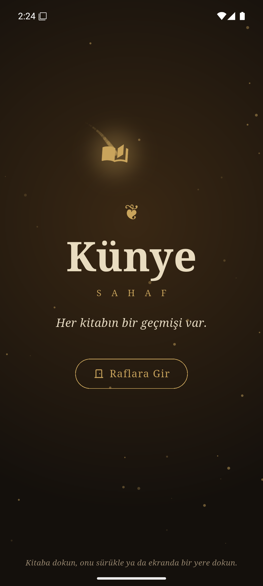
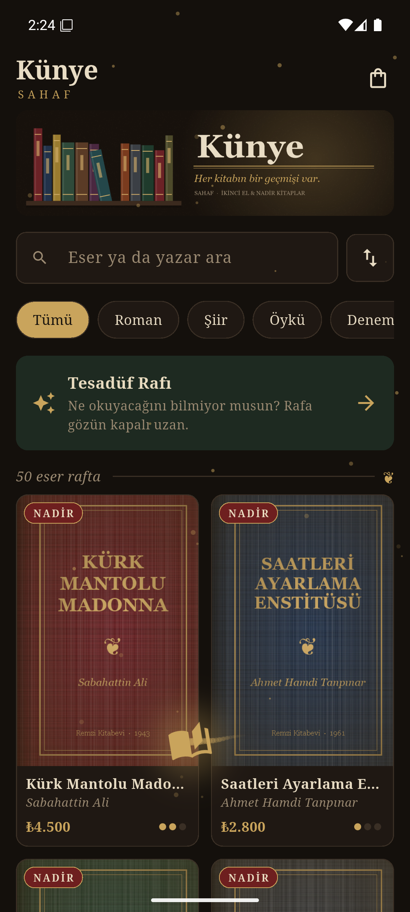
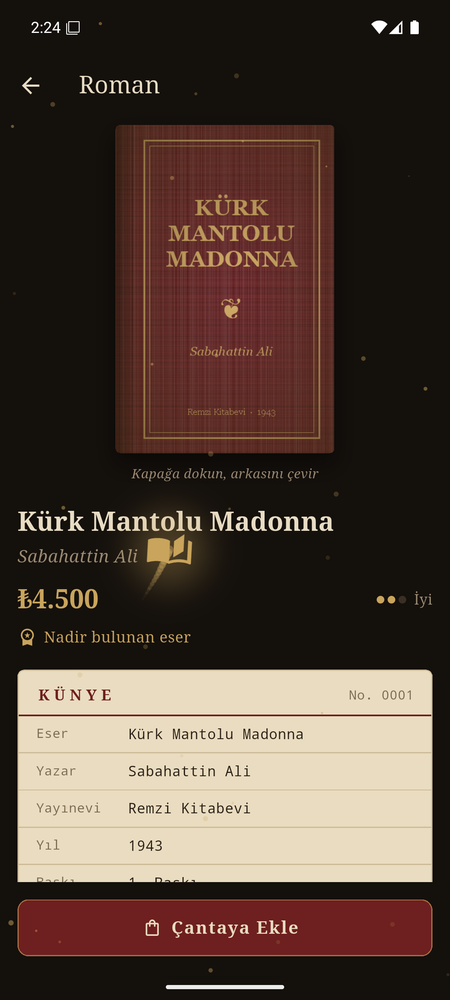
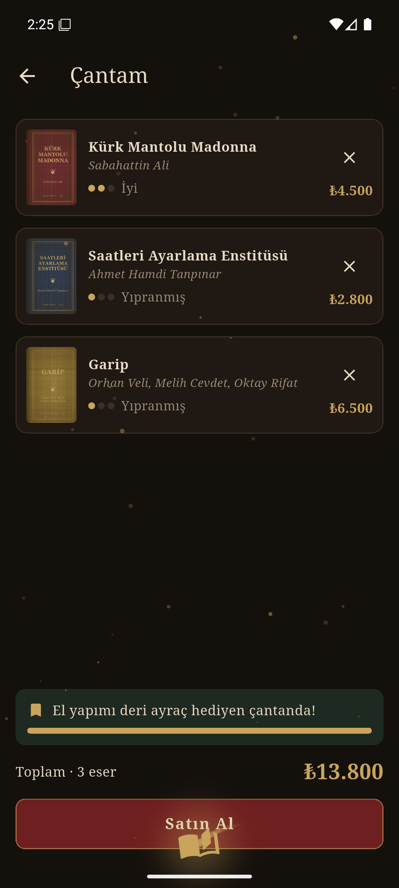
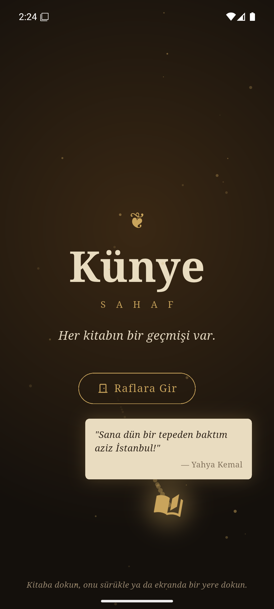
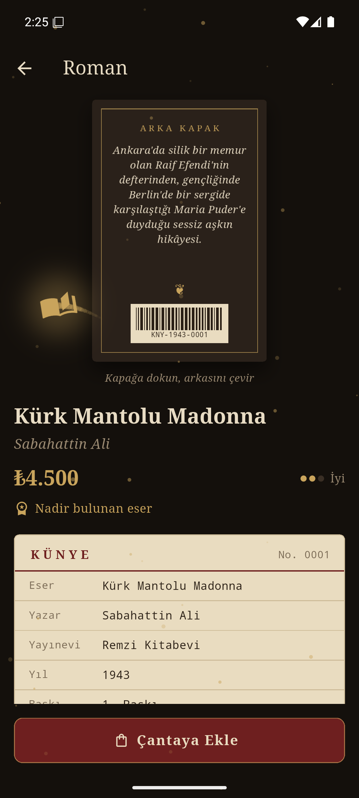
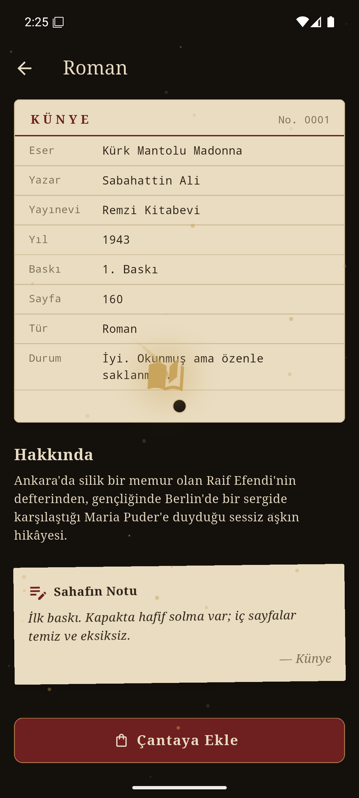

<p align="center">
  
</p>

<h1 align="center">Künye</h1>

<p align="center"><i>Her kitabın bir geçmişi var.</i></p>

<p align="center">
  
  
  
  
</p>

---

**Künye**, ikinci el ve nadir kitaplar satan hayali bir sahafın mobil kataloğudur. Türk edebiyatından 50 eser, beş rafta okurunu bekliyor: Roman, Şiir, Öykü, Deneme ve Dergi. Her eser tek nüshadır ve kendi hikâyesini taşır. Uygulamada bu hikâye, eserin yayın künyesi, fiziksel durumu ve sahafın o nüsha için düştüğü not olarak yer alır.

Arayüz **dark academia** estetiğiyle tasarlandı: ceviz raflar, eski deri, parşömen kâğıt, yaldız ve öküz kanı cilt. Uygulama, Flutter eğitimi kapsamındaki *Mini Katalog* projesi olarak yalnızca Flutter SDK ile geliştirildi.

## Ekranlar

<table>
  <tr>
    <td align="center" width="25%"><br><b>Karşılama</b></td>
    <td align="center" width="25%"><br><b>Raflar</b></td>
    <td align="center" width="25%"><br><b>Kitap Detayı</b></td>
    <td align="center" width="25%"><br><b>Çantam</b></td>
  </tr>
  <tr>
    <td align="center"><br><b>Gezgin Kitap</b></td>
    <td align="center"><br><b>Arka Kapak</b></td>
    <td align="center"><br><b>Künye Kartı</b></td>
    <td></td>
  </tr>
</table>

## Öne Çıkanlar

**Gezgin Kitap**
Uygulamaya girildiği andan itibaren ekranda bir kitap süzülür. Sayfalarını kanat gibi çırparak dolaşır ve arkasında yaldız tozu bırakır. Sürüklenip fırlatılabilir. Üstüne dokunulduğunda Orhan Veli'den, Tanpınar'dan ya da Cemal Süreya'dan bir dize söyler.

**Künye Kartı**
Her eserin yayın bilgileri eski bir kütüphane fişi gibi sunulur: yayınevi, yıl, baskı, sayfa sayısı ve kitabın durumu.

**Arka Kapak**
Kapağa dokunulduğunda kitap üç boyutlu olarak döner ve arka kapağındaki tanıtım yazısını ve nüshaya özel barkodu gösterir.

**Sahafın Notu**
Her nüshanın kendine ait küçük bir hikâyesi vardır: sayfaların arasından çıkan bir tren bileti, kurutulmuş bir menekşe ya da kenarlara düşülmüş notlar.

**Tesadüf Rafı**
Ne okuyacağını bilmeyenler için raftan rastgele bir eser seçer.

**Tek Nüsha Çantası**
Sahafta her kitaptan yalnızca bir tane vardır, bu yüzden aynı eser çantaya iki kez eklenemez. Üç eserlik alışverişte el yapımı ayraç hediye edilir.

## Kapsanan Konular

| Konu | Uygulamadaki karşılığı |
|---|---|
| Widget yapısı | Stateless ve Stateful widget'lar, yeniden kullanılabilir bileşenler |
| Sayfa geçişleri | Named routes: karşılama, raflar, detay ve çanta |
| Route Arguments | Seçilen eserin detay sayfasına taşınması |
| Sayfadan veri döndürme | Detay sayfasından çantaya eklenen eserin geri gönderilmesi |
| JSON ve model | `books.json` → `jsonDecode` → `Book.fromJson` / `toJson` |
| Listeleme | `GridView.builder` ile kitap kartları, `ListView` ile çanta |
| Arama ve filtreleme | Türkçe harflere duyarsız arama, kategori filtresi, sıralama |
| State yönetimi | `setState` ile çanta ve sayaç güncellemesi |
| Asset yönetimi | JSON verisi, banner ve 50 kapak görseli |
| Animasyon | `AnimationController`, `Ticker`, `CustomPainter`, 3B dönüşüm |

## Teknik Yapı

| Katman | İçerik |
|---|---|
| `app/` | Tema ve sayfa rotaları |
| `models/` | Kitap, kitap durumu, çanta ve sıralama |
| `data/` | JSON veri kaynağı ve dizeler |
| `screens/` | Karşılama, raflar, kitap detayı, çanta |
| `widgets/` | Kitap kartı, künye kartı, dönen kapak, gezgin kitap katmanı ve diğer bileşenler |

## Kurulum

**Gereksinimler:** Flutter 3.47.7 (Dart 3.13.5), Android emülatör ya da cihaz

```bash
git clone https://github.com/iil-0/kunye.git
cd kunye
git checkout kunye
flutter pub get
flutter run
```

Testler için:

```bash
flutter test
```

---

<sub>Eserler ve yazarları gerçektir. Baskı bilgileri, kitap durumları, fiyatlar ve sahaf notları kurgusaldır. Kapak görselleri ve banner bu proje için hazırlanmıştır. Uygulamadaki dizeler sahiplerine aittir.</sub>
